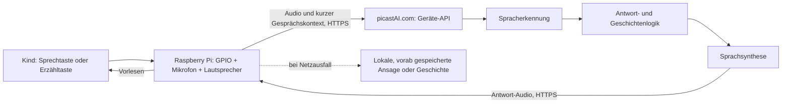

# Ritter Kunibert – Softwarearchitektur für den Audio-Prototyp

> **Aktualisierung (November 2026):** Dies ist der ursprüngliche Architekturvorschlag. Inzwischen gibt es einen Pi-Client (`pi-client/`) und einen Node-Server (`server.ts`, `server-api/`) mit Spracherkennung, Sicherheitsweiche, Erzählmotor und Sprachsynthese. Die Plattform heißt **picastAI.com** (nicht `picast.com`, siehe unten). Maßgeblich für die aktuelle Schnittstelle ist `docs/picastAI-Pi-API.md`, für das Sprachmodell `docs/LLM-Anbieter.md`.

**Stand: 2. Oktober 2026 · Architekturvorschlag, noch keine implementierte Geräte-Software.** Die Adressierung über `picast.com` ist ein gewünschtes Ziel, keine bereits vorhandene Schnittstelle *(veraltet: Die Plattform heißt inzwischen picastAI.com, siehe Hinweis oben)*: [picast.com](https://picast.com) zeigte damals eine Domain-Verkaufsseite. Die folgende Architektur setzt voraus, dass die Domain später kontrolliert und mit einem eigenen HTTPS-Dienst verbunden wird. **Kein Erwerb ist erfolgt.**

## Leitentscheidung: Das Gerät ist eine Stimme, kein kleiner KI-Server

Der Raspberry Pi übernimmt **nur Bedienung, Aufnahme, Wiedergabe und ein wenig flüchtigen Sitzungszustand**. Hinter `picastAI.com` (im Entwurf: `picast.com`, veraltet) laufen Spracherkennung (STT), Antwort-/Geschichtenerzeugung (LLM), Sicherheitslogik und Sprachsynthese (TTS). Der Pi spricht für Online-Antworten ausschließlich mit dieser eigenen HTTPS-Schnittstelle; die Zugangsschlüssel zu externen KI-Diensten liegen **nur auf dem Server**. Das ist für einen ersten Prototypen einfacher zu warten und ermöglicht eine gute deutsche Erzählstimme ohne großes Gerät. Nachteil: Internet und Backend sind für neue Antworten erforderlich.

## Auf dem Raspberry Pi

**System:** Raspberry Pi OS Lite; ein Python-Prozess als `systemd`-Dienst, der beim Start automatisch läuft und nach Absturz neu startet. Audio zunächst über ALSA/USB-Geräte; GPIO über `gpiozero`. Keine Bildschirmoberfläche und keine dauerhaft geöffnete Mikrofonleitung.

| Modul | Aufgabe |
| --- | --- |
| `controls` | Sprechtaste, Erzähltaste, Lautstärke, physischer Mikrofon-Aus-Zustand und Statuslicht lesen/anzeigen. |
| `recorder` | Nur bei Tastendruck aufnehmen; feste Obergrenze (z. B. 20 Sekunden), Sprachformat vereinheitlichen, Aufnahme danach aus flüchtigem Speicher entfernen. |
| `session` | Nur die letzten wenigen Äußerungen bzw. den aktuellen Geschichtenstand im Arbeitsspeicher halten; nach Inaktivität verwerfen. Keine dauerhafte Kinderprofil-Datei im ersten Prototyp. |
| `api_client` | Authentifizierte HTTPS-Anfragen an den eigenen Dienst mit Timeout, begrenzten Wiederholungen und Größenbegrenzung. Keine externen KI-API-Schlüssel im Gerät. |
| `player` | Antwort-Audio abspielen; Sprechtaste kann die Wiedergabe unterbrechen. Während des Abspielens keine parallele Aufnahme. |
| `fallback` | Bei fehlendem Netz eine **vorab gespeicherte** Meldung oder Geschichte spielen; keine erfundene Online-Antwort vortäuschen. |

**Zustandsautomat:** `BEREIT → AUFNAHME → VERARBEITUNG → WIEDERGABE → BEREIT`. Mit Mikrofon-Aus: `BEREIT → MIKROFON_AUS`; bei Fehler: `VERARBEITUNG → OFFLINE_HINWEIS → BEREIT`. Die Aufnahme-LED muss den tatsächlichen Mikrofonzustand widerspiegeln. Für einen späteren Kinder-Prototypen sollte ihr Wahrheitsgehalt elektrisch mit der Mikrofonfreigabe abgesichert werden, nicht nur durch eine UI-Variable.

## Hinter picastAI.com

Ein kleiner API-Server (beispielsweise TypeScript/Node oder Python/FastAPI) kapselt die Anbieter. Damit können Erzählmodell und Stimme gewechselt werden, ohne Geräte neu zu verkabeln.

1. **Gerätezugang:** jedes Gerät hat eine eigene, widerrufbare Identität; TLS, Rate Limits und Größenlimits. Keine unbegrenzte öffentliche Audio-API.
2. **STT:** deutsches Kinderdeutsch erkennen; bei Unsicherheit lieber freundlich nachfragen als eine riskante Frage erraten.
3. **Router:** unterscheiden zwischen allgemeiner Frage, Kunibert-Geschichte, Fortsetzung und möglichem Sicherheitsfall. Fragen zur Welt werden sachlich beantwortet, nicht erzwungen in eine Rittergeschichte verpackt.
4. **Geschichtenmotor:** feste *Erinnerungsanker* (Dachzimmer, Kutscher, Pflastersteine, Wald, Hexe, Drache, Rückkehr), aber flexible Auswahl; pro Episode Figuren/Ort/Problem/Variation/aktuellen Bogen führen. Keine Behauptung eines rekonstruierten Originaltexts oder einer echten Vaterstimme.
5. **Sicherheitsprüfung:** vor dem Vorlesen prüfen, ob die Antwort zum Alter und zur Frage passt; bei Notlagen nicht in eine Fantasiegeschichte ausweichen und niemals eine exklusive Elternrolle beanspruchen. Vor realer Kinder-Nutzung braucht dieser Teil fachliche Tests und ein angemessenes Eskalationskonzept.
6. **TTS:** eigenen warmen deutschsprachigen Erzählerklang verwenden; längere Geschichten in kurze hörbare Abschnitte teilen. Keine Stimmenimitation ohne ausdrückliche Einwilligung.

## API-Vertrag für einen ersten Durchstich

- `POST /v1/turn`: Geräte-ID/Auth, Modus (`frage`, `geschichte`, `weiter`), Sprachaufnahme und ein kleines Sitzungs-/Geschichten-Token. Antwort: `turn_id`, `kind`, optionaler Text zur Diagnose, nächster flüchtiger Geschichtenstand und ein **kurzlebiger, geschützter** Verweis auf die Audioantwort.
- `GET /v1/turn/{id}/audio`: Audio ausschließlich für das authentifizierte Gerät und nur kurz nach Erzeugung; danach löschen. Keine öffentlichen, dauerhaften Kinder-Audio-Links.
- `GET /health`: Betriebsbereitschaft für Betreiber, ohne Kinderinformationen.

Die erste Version ist **halbduplex**: Das Kind spricht, wartet, hört zu. Kein dauerhaft offenes Mikrofon, kein Wake Word und keine Echtzeit-Duplex-Verbindung. Für längere Erzählungen erzeugt der Server kurze Folgen; das Kind entscheidet mit „weiter“ oder der Erzähltaste. Streaming kann folgen, wenn die Wartezeit nach realen Tests zu lang ist.

## Datenschutz und robuste Betriebsweise

- Audio nur für den aktuellen Turn übertragen; auf Pi und Server nach Verarbeitung löschen. Vor dem echten Einsatz **konkrete Aufbewahrungsfristen und Anbieter-Datenflüsse** festlegen und prüfen – ein Architekturziel ist noch keine überprüfte Datenschutzgarantie.
- Standardmäßig keine Gesprächstranskripte, Kinderprofile oder automatisch an Erwachsene verschickte Mitschnitte speichern. Diagnoseprotokolle enthalten Fehlercodes, aber weder Stimme noch Fragen.
- Pro Gerät eigene Zugangsdaten, serverseitige Schlüsselverwaltung, Sperr- und Erneuerungsmöglichkeit. Bei Verlust des Geräts muss sein Zugang widerrufen werden können.
- Timeouts, eine freundliche Offline-Ansage und ein lokaler Audiotest verhindern stummes „Hängenbleiben“; Wiedergabelautstärke begrenzen.
- Softwareupdates signieren bzw. aus einer kontrollierten Quelle beziehen; vor unbegleiteter Nutzung Funktionen und Antwortqualität mit Erwachsenen testen.

## Was wir zuerst implementieren würden

**Durchstich 1:** Taste → wenige Sekunden Aufnahme → Test-API → kurze Antwort → Lautsprecher. **Durchstich 2:** zwei Modi (Frage/Geschichte), kurze Kunibert-Episode und „weiter“. **Durchstich 3:** Mikrofon-Aus, Offline-Fallback, Geräteauthentifizierung, Löschung und Tests schwieriger Kinderfragen. Erst danach Gehäuse, Akku und unbeaufsichtigte Nutzung beurteilen.

**Offene Voraussetzung (veraltet, Stand 2. Oktober 2026; die Plattform heißt inzwischen picastAI.com):** Ist `picast.com` eine noch zu erwerbende/zu kontrollierende Domain für euren eigenen Dienst, oder war ein anderer bestehender Anbieter gemeint? Bis das geklärt ist, implementieren wir die API gegen eine austauschbare lokale Testadresse – nicht gegen eine fiktive Picast-API.
