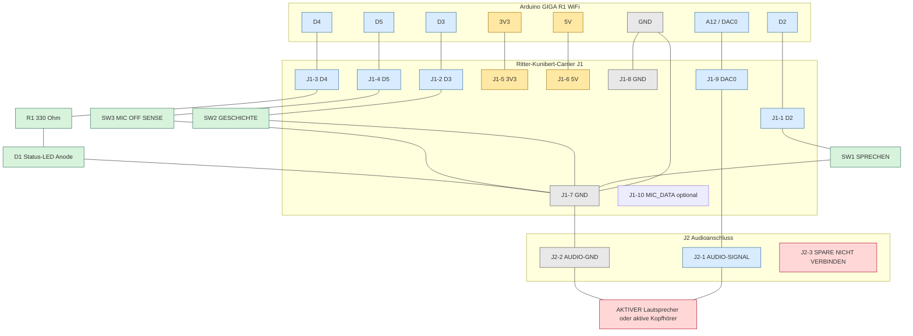

# Exakte Verdrahtung – Arduino GIGA, Carrier, Taster und DAC

**Firmware-Pins:** D2, D3, D4, D5, A12/DAC0  
**Carrier:** Ritter Kunibert GIGA Carrier v0.1  
**Logik:** `INPUT_PULLUP`, daher werden Taster gegen GND geschaltet.

## 1. Gesamtübersicht als ASCII-Schaltplan

```text
                         ARDUINO GIGA R1 WiFi
                    ┌───────────────────────────┐
                    │                           │
       D2 ──────────┤ D2                    3V3 ├──── optional J3-1
       D3 ──────────┤ D3                     5V ├──── optional J4-1
       D4 ──────────┤ D4                    GND ├──── J1-7/J1-8
       D5 ──────────┤ D5                         │
                    │                           │
  A12 / DAC0 ───────┤ DAC0                       │
                    └─────────────┬─────────────┘
                                  │
                       USB-C-Netzteil/Programmierung

        J1 der Carrier-Platine: 2×5, Kabelverbindung zum GIGA
        ┌─────────────────────────────────────────────────────┐
        │ J1-1 D2 ────────────────┐                           │
        │ J1-2 D3 ────────────────┼── Signalleitungen         │
        │ J1-3 D4 ────────────────┤                           │
        │ J1-4 D5 ────────────────┘                           │
        │ J1-5 3V3                                           │
        │ J1-6 5V                                             │
        │ J1-7 GND                                            │
        │ J1-8 GND                                            │
        │ J1-9 DAC0                                           │
        │ J1-10 MIC_DATA (optional, hier nicht verwendet)     │
        └─────────────────────────────────────────────────────┘

        Carrier-Eingänge und LED:

        J1-1 / D2 ──────── SW1 „SPRECHEN“ ──────── GND (J1-7)
        J1-2 / D3 ──────── SW2 „GESCHICHTE“ ────── GND (J1-7)
        J1-4 / D5 ──────── SW3 „MIC OFF“ ───────── GND (J1-7)
        J1-3 / D4 ──────── R1 330 Ω ── LED-Anode
                                            LED-Kathode ── GND (J1-7)

        Carrier-Audioanschluss J2:

        J1-9 / A12-DAC0 ─── J2-1 AUDIO-SIGNAL ───┐
                                                  │
                                      aktiver Lautsprecher/
                                      aktiver Kopfhörer
                                                  │
        J1-7 / GND ─────── J2-2 AUDIO-GND ───────┘
        J2-3 SPARE: nicht anschließen
```

## 2. Pin-für-Pin-Tabelle

| Arduino-GIGA-Pin | Carrier-Pin | Verbindung | Zustand/Funktion |
|---|---|---|---|
| D2 | J1-1 | SW1 → GND | `LOW` beim Drücken; Aufnahme starten |
| D3 | J1-2 | SW2 → GND | `LOW` beim Drücken; Geschichte anfordern |
| D4 | J1-3 | D4 → R1 330 Ω → LED-Anode | LED-Ausgang während Aufnahme |
| D5 | J1-4 | SW3 → GND | `LOW` bei Mikrofon-Aus-Sense |
| 3V3 | J1-5 | optional J3-1/J4-2 | 3,3-V-Versorgung, nicht für Lautsprecher |
| 5V | J1-6 | optional J4-1 | 5-V-Versorgung, nicht an GPIO legen |
| GND | J1-7/J1-8 | gemeinsame Masse | Rückleiter für Taster, LED und Audio |
| A12 / DAC0 | J1-9 | J2-1 | analoges DAC-Audiosignal |
| optional | J1-10 | J3-3 | externer Mikrofon-Datenanschluss |

## 3. Mermaid-Schaltplan



## 4. Tasterkontakte

### SW1 – Sprechen

```text
GIGA D2 ── Carrier J1-1 ── SW1 Kontakt 1
SW1 Kontakt 2 ──────────── Carrier J1-7 / GND
```

### SW2 – Geschichte

```text
GIGA D3 ── Carrier J1-2 ── SW2 Kontakt 1
SW2 Kontakt 2 ──────────── Carrier J1-7 / GND
```

### SW3 – Mikrofon-Aus-Sense

```text
GIGA D5 ── Carrier J1-4 ── SW3 Kontakt 1
SW3 Kontakt 2 ──────────── Carrier J1-7 / GND
```

Die Firmware setzt D2, D3 und D5 mit `INPUT_PULLUP`. Deshalb sind keine externen Pull-up-Widerstände für diese drei Leitungen erforderlich.

## 5. LED-Kontakte

```text
GIGA D4
  │
  └── Carrier J1-3 ── R1 330 Ω ── LED-Anode (+)
                                  LED-Kathode (-) ── Carrier J1-7 / GND
```

Bei einer 5-mm-LED ist das längere Bein normalerweise die Anode. Vor dem Einschalten die Polarität prüfen.

## 6. DAC-Audioausgang

```text
GIGA A12 / DAC0 ── Carrier J1-9 ── J2-1 AUDIO-SIGNAL
GIGA GND        ── Carrier J1-7 ── J2-2 AUDIO-GND
Carrier J2-3    ── offen lassen
```

An J2 ausschließlich anschließen:

- aktive Kopfhörer oder
- aktiver Lautsprecher mit eigener Verstärkung.

**Keinen passiven Lautsprecher direkt an DAC0 anschließen.** Der GIGA besitzt keinen integrierten Leistungsverstärker.

## 7. Elektrische Prüfung vor dem Einschalten

1. USB-C und Netzteil abziehen.
2. Durchgang prüfen: GIGA D2 → J1-1, D3 → J1-2, D4 → J1-3, D5 → J1-4.
3. Prüfen, dass D2, D3, D4 und D5 keinen Kurzschluss zu 5 V oder 3V3 haben.
4. SW1, SW2 und SW3 jeweils nur im gedrückten/geschlossenen Zustand gegen GND messen.
5. LED-Anode hinter R1 und LED-Kathode an GND prüfen.
6. Prüfen, dass J2-1 nicht mit 5 V oder 3V3 verbunden ist.
7. Erst danach USB-C anschließen und die Firmware starten.

## 8. Abgrenzung zur echten Mikrofonabschaltung

SW3 schaltet in dieser Verdrahtung nur das **D5-Sense-Signal**. Für eine echte elektrische Mikrofonabschaltung muss zusätzlich die Mikrofonversorgung über den vorgesehenen DPST-/DPDT-Schalter getrennt werden. D5 allein ist keine Hardware-Datenschutzabschaltung.
